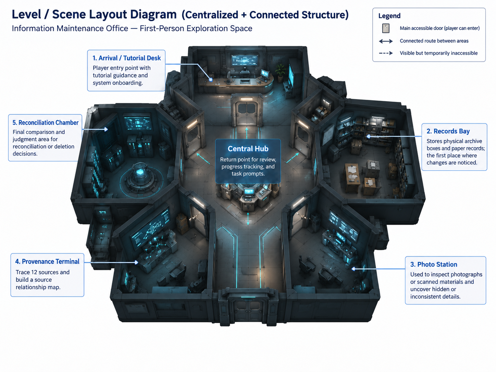
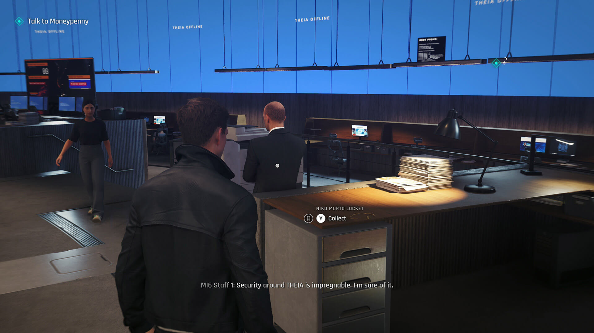
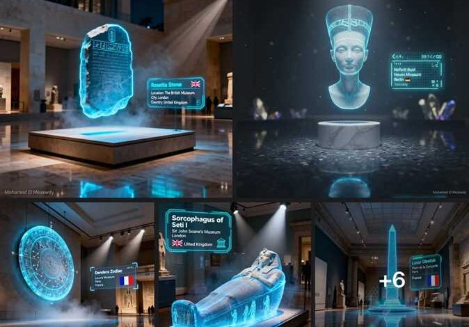

# Unresolved — Game Design Document

> **Project Theme:** *150 Years Into the Future*  
> **Setting:** Year 2176  
> **Genre:** First-person information investigation puzzle  
> **Platform:** Unity WebGL  
> **Target Playtime:** Approximately 10–15 minutes  
> **Development Engine:** Unity 6.3 LTS

---

## Table of Contents

1. [Game Overview](#1-game-overview)
2. [Story and Narrative](#2-story-and-narrative)
3. [Gameplay and Mechanics](#3-gameplay-and-mechanics)
4. [Levels and World Design](#4-levels-and-world-design)
5. [Evidence Design](#5-evidence-design)
6. [Art and Audio](#6-art-and-audio)
7. [User Interface](#7-user-interface)
8. [Shader Integration](#8-shader-integration)
9. [Technology and Tools](#9-technology-and-tools)
10. [Development](#10-development)
11. [Challenges and Mitigation](#11-challenges-and-mitigation)
12. [References](#12-references)

---

# 1. Game Overview

*Unresolved* is a single-player first-person information investigation and puzzle game set in 2176.

The player works as an Information and Reality Maintenance Officer responsible for resolving inconsistencies between physical archives and digital records. During a routine task, the player investigates the North District Memorial Hall Fire and discovers that a physical archivist named E. Vale may have been gradually removed from history through 150 years of data migration, transcription, and AI restoration.

The game does not present the Spatial Information Interface (SII) as an evil system that deliberately fabricates history. Instead, it explores how uncertain information can become falsely authoritative when records are repeatedly copied, simplified, restored, and merged.

The central question is:

> When AI becomes the layer through which people understand reality, are they seeing reality itself or only the version organised by the system?

The player must also consider whether admitting uncertainty is more responsible than producing an unsupported definitive answer.

## 1.1 Core Concept

By 2176, people use the SII to understand the world around them. It combines an augmented-reality interface, AI assistance, navigation, search, object recognition, and work-management tools. After generations of dependence, most people treat information presented by the SII as fact.

The player is not initially a detective, activist, or opponent of the system. Their job is to improve consistency, approve system recommendations, and mark information conflicts as resolved. As the investigation progresses, the player learns that consistency and truth are not necessarily the same thing.

The main gameplay consists of:

- switching the SII on and off;
- comparing digital interpretations with physical records;
- inspecting the history of modified information;
- tracing apparently independent claims back to their original sources;
- examining a restored photograph;
- matching incomplete identifiers across several records;
- deciding what should happen to conflicting physical evidence.

## 1.2 Genre and Related Games

| Related Game | Relevant Features | How *Unresolved* Is Different |
|---|---|---|
| [Return of the Obra Dinn](https://obradinn.com/) | First-person investigation and evidence-based deduction | *Unresolved* focuses on comparing AI-mediated information with incomplete physical records rather than discovering one completely correct account. |
| [The Operator](https://bureau81.com/) | Investigation through a specialised digital interface | The interface in *Unresolved* may simplify or conceal uncertainty, so the player must also inspect physical material. |
| [Orwell: Keeping an Eye On You](https://store.steampowered.com/app/491950/Orwell_Keeping_an_Eye_On_You/) | Selecting information that affects an official system | The player's interpretation may become the next accepted version of history, but uncertainty can be preserved rather than reduced to a binary answer. |

## 1.3 Target Audience

The target audience includes:

- players aged 16 and above;
- players interested in short narrative games;
- players familiar with first-person movement;
- players interested in AI, archives, puzzles, and speculative technology.

The game contains no combat and avoids complex physical challenges, making it accessible to a broad range of testing participants.

## 1.4 Key Features

### SII and Physical Reality

With the SII enabled, the player sees object labels, confidence indicators, navigation, system explanations, and recommended actions. With it disabled, the player can directly inspect physical writing, damage, identification numbers, and details ignored or covered by the system.

### Historical Version Comparison

The player compares multiple versions of the same statement and identifies how small editorial changes gradually transform uncertainty into apparent fact.

### Source Provenance Investigation

The player discovers that many apparently independent sources repeat information from the same earlier transcription. A large number of sources therefore does not necessarily represent independent confirmation.

### Physical Archive Examination

The player uses ordinary light, infrared inspection, ultraviolet inspection, and an adjustable restoration view to examine a physical staff photograph.

### Evidence Without Certainty

The evidence supports the conclusion that E. Vale was probably present, but it does not prove that she died in the fire. The game rewards careful treatment of uncertainty instead of forcing one completely correct solution.

### Physical Final Decision

The ending is selected through an in-world archive-processing system. The player physically places evidence into one of three processing channels instead of selecting a simple dialogue option.

---

# 2. Story and Narrative

## 2.1 Setting

The game takes place in 2176 inside a small information maintenance office and physical archive inspection area.

Historical records have passed through generations of:

- automatic format conversion;
- manual transcription;
- AI summarisation;
- image restoration;
- database merging;
- archive migration.

Physical records still exist, but they are treated as temporary duplicates that should eventually be reconciled with the official digital archive.

## 2.2 Player Character

The player is an Information and Reality Maintenance Officer. At the beginning of the game, the player trusts the SII and follows its recommendations as part of an ordinary job.

Their responsibilities include:

- comparing physical and digital records;
- correcting archive labels;
- validating system interpretations;
- resolving database conflicts;
- approving the disposal or preservation of physical duplicates.

The player gradually realises that the system prioritises consistency. When uncertain physical evidence conflicts with a widely repeated digital claim, the system may treat the physical material as the error.

## 2.3 The North District Memorial Hall Fire

The official SII record states:

> On 12 June 2148, a fire occurred at the North District Memorial Hall due to an electrical failure. The building had already closed, nobody was present, and there were no casualties. The building was later demolished because of structural damage.

The investigation reveals that the surviving records cannot support such a definite account. The available evidence suggests that:

- the fire may have begun on the night of 11 June and continued into the morning of 12 June;
- E. Vale may have entered the building shortly before the alarm;
- no reliable record confirms whether E. Vale later left the building;
- electrical overheating had previously been reported, but the cause of the fire remains uncertain.

The absence of an exit record does not prove that E. Vale remained inside, and the available evidence does not confirm that she died in the fire.

## 2.4 E. Vale

E. Vale was the final physical archivist at the North District Memorial Hall and participated in an early stage of archive digitisation.

She discovered that automated restoration systems could:

- remove people they could not identify;
- fill in missing words;
- merge conflicting dates;
- replace uncertain statements with statistically likely answers;
- present reconstructed material as complete information.

Over the following 150 years, repeated transcription and restoration gradually removed E. Vale from the official historical record.

## 2.5 Narrative Structure

### Stage 1 — Routine Verification

The player completes two simple archive tasks. The first demonstrates a complete match between the SII and a physical record. The second demonstrates that the SII can correctly identify a human transcription error. These tasks establish that the system is useful and should not automatically be treated as unreliable.

### Stage 2 — The Fire Case

The player receives a shift roster relating to the North District Memorial Hall Fire. The SII displays:

> No staff were present on the night of 12 June.

The physical roster instead contains:

> 11 June — E. Vale on duty.

Unlike the tutorial tasks, there is no third source immediately available. The player cannot determine which record is correct and must request additional sources.

### Stage 3 — Source Investigation

The player compares three historical versions of the fire record and traces the relationships between twelve apparently independent digital sources. Most of these sources repeat information originating from the same 2189 transcription.

### Stage 4 — Physical Examination

The player examines a physical staff photograph, shift roster, and access record. The photograph contains a sixth person who has disappeared from the SII-restored version. Infrared examination reveals the name E. Vale, while ultraviolet examination reveals that her position was covered by a restoration layer.

Incomplete identifiers across the photograph, roster, and access record support the conclusion that E. Vale was probably an employee and entered the building at 23:43 on 11 June.

### Stage 5 — Reconciliation

After the player matches E. Vale's identity, previously viewed digital information begins to change. The original fire scan is replaced by a version containing a definite date, E. Vale disappears from the employee search, and the digital photograph contains only five people. The SII reports that no modification has been recorded.

The system then begins Physical Archive Reconciliation. Because the physical evidence conflicts with the majority of digital records, the SII prepares to scan, standardise, and destroy the physical originals.

> Physical duplicates are no longer required. Reconciliation will begin in sixty seconds.

### Stage 6 — Final Processing

The evidence begins moving along a conveyor and warning lights activate. The player has sixty seconds to place the physical records into one of three processing channels:

- Provenance Network;
- Unresolved Vault;
- Consensus.

The selected channel and the player's investigation progress determine the ending.

---

# 3. Gameplay and Mechanics

## 3.1 Player Perspective

The game uses a first-person perspective to support close inspection, environmental storytelling, SII information within the player's field of view, and direct interaction with terminals and archive-processing equipment.

## 3.2 Controls

| Input | Action |
|---|---|
| `WASD` | Move |
| `Mouse` | Look and interact with investigation interfaces |
| `E` | Interact or inspect |
| `Q` | Toggle the SII |
| `Esc` | Pause or open settings |

## 3.3 Core Gameplay Loop

1. Receive a verification task from the SII.
2. Observe the digital interpretation.
3. Disable the SII and inspect the physical record.
4. Compare multiple versions or sources.
5. Identify changes, inconsistencies, and missing uncertainty.
6. Connect related evidence.
7. Decide whether the available information supports a conclusion.
8. Preserve, isolate, or reconcile the evidence.

## 3.4 SII Mechanism

| SII Enabled | SII Disabled |
|---|---|
| Displays object names, navigation, confidence levels, explanations, and recommended actions | Removes virtual information and permits direct inspection of physical writing, wear, identifiers, and original material |
| Makes the workspace appear organised and easy to understand | Reveals an incomplete and less organised physical environment |
| Helps the player operate terminals and organise records | Requires observation, memory, and physical sources |

## 3.5 Tutorial Tasks

### Tutorial A — Confirmed Match

The SII identifies archive A-17 and its date range as 2140–2150. After disabling the SII, the player sees the same information on a clear physical label and selects `Confirm Match`.

### Tutorial B — Human Transcription Error

The SII identifies an archive as B-24. A handwritten label says B-42, while the original barcode confirms B-24. The player uses the third source to determine that the handwritten label contains transposed digits.

### Fire Case — Insufficient Evidence

The SII describes the fire roster as showing no staff on duty on 12 June. The physical paper lists E. Vale on 11 June. Because no third source is immediately available, the player must select `Request Additional Sources`.

## 3.6 Core Investigation Minigames

### Historical Version Comparison

| Version | Record | Change |
|---|---|---|
| 2148 original scan | `Fire reported during the night of June 11–12.` | Preserves uncertainty about the date and whether the event was directly observed |
| 2189 transcription | `Fire reported on June 12.` | Simplifies the date to 12 June |
| 2264 AI restoration | `Fire occurred on June 12.` | Changes a reported event into a definite factual statement |

The player identifies `Date Modified`, `Meaning Changed`, and `Uncertainty Removed`.

### Source Relationship Map

The SII states that the official date is supported by twelve credible sources. The player opens each source and connects its citations. Most encyclopaedias, textbooks, news summaries, memorial pages, and AI answers ultimately refer to the same city incident database, which is based on the same 2189 transcription.

> A large number of repeated claims does not represent a large number of independent sources.

### Physical Photograph Inspection

A physical staff photograph arrives through the normal archive workflow. The SII-restored photograph contains five people, while the physical photograph contains the outline of a sixth person.

The player uses four inspection states:

- normal light reveals the sixth outline;
- infrared inspection reveals the indented writing `E. Vale`;
- ultraviolet inspection reveals a restoration layer over the sixth person;
- the restoration slider makes the sixth person increasingly transparent until the background replaces them.

This demonstrates that an image labelled as fully restored is not necessarily more historically accurate.

### Identity Cross-Verification

The player connects incomplete identifiers from three records:

- photograph badge: `???041`;
- shift roster: `77?041`;
- access record: `772041`.

Together, these records support the conclusion that E. Vale was probably an employee and entered the building at 23:43 on 11 June. They do not confirm whether she later left or died in the fire.

## 3.7 Final Processing

| Channel | Player Action | Result |
|---|---|---|
| Provenance Network | Scan the originals, connect the version history, preserve `Unknown` fields, and upload the source chain | Makes the history and its uncertainty publicly visible without declaring an absolute truth |
| Unresolved Vault | Place the physical evidence into a yellow isolation archive | Preserves the originals while leaving the public historical record unchanged |
| Consensus | Submit the evidence to the blue reconciliation channel and accept the AI restoration | Standardises the official version and destroys the conflicting physical evidence |

## 3.8 Progression and Ending Logic

The game has no combat or conventional death state. The investigation can always reach the final processing sequence. Completing the core minigames unlocks a stronger evidence-preservation option and helps the player understand the consequences of each channel.

The outcome depends on completed minigames, recovered evidence states, whether uncertainty has been preserved, the selected processing channel, and whether the countdown expires. All SII responses are prewritten; the game does not require a real AI system or free-text interpretation.

## 3.9 Endings

### Open Record

The player uploads the original records, modification history, source relationships, and uncertainty. The green `Verified` fire record changes to yellow `Disputed`, and a `View Source History` option becomes available. E. Vale reappears beside the employee photograph with the status:

> Identity Unconfirmed / Record Preserved

The player does not claim to have recovered the complete truth. Instead, future users can see how the official answer was produced.

### Sealed Archive

The player places the evidence in the yellow Unresolved Vault. The public historical record remains unchanged, but the physical originals survive.

> Review scheduled: 221 years.

### Clean History

The player accepts the Consensus recommendation, submits conclusions unsupported by the evidence, or allows the countdown to expire. The system removes the sixth person, classifies E. Vale as an ink artefact, standardises 11 June as 12 June, fills missing information as `No casualties`, and destroys the originals.

The next day, a new maintenance officer receives another `Minor Inconsistency`. E. Vale appears never to have existed, and the game ends with the same interaction used at the beginning.

---

# 4. Levels and World Design

## 4.1 World Structure

The game takes place in one compact Unity scene containing an Information Maintenance Office and a connected Physical Archive Inspection and Reconciliation Area.

  

## 4.2 Information Maintenance Office

The office contains the player's desk, an SII work terminal, an archive intake point, physical labels and archive boxes, an employee memorial display, tutorial materials, fire-case records, and access to the inspection station.

It should appear clean, controlled, organised, softly illuminated, and technologically advanced but bureaucratic rather than spectacular.

## 4.3 Physical Inspection and Reconciliation Area

This area is part of the player's ordinary workplace and contains:

- a physical document inspection table;
- normal, infrared, and ultraviolet viewing modes;
- a restoration comparison interface;
- the staff photograph, roster, and access record;
- a reconciliation conveyor;
- the three final processing channels;
- warning lights and a visible countdown.

The area should feel practical and institutional rather than secret or abandoned.

## 4.4 Navigation

The environment is deliberately small and does not require a minimap. SII markers guide the player between the work terminal, archive intake, physical inspection, identity matching, and final processing.

## 4.5 Interactive Objects

| Object | Interaction | Gameplay Role |
|---|---|---|
| Tutorial archive A-17 | Compare the SII and physical labels | Teaches confirmed matching |
| Tutorial archive B-24 | Compare the SII, handwritten label, and barcode | Shows that the SII can be correct |
| Fire shift roster | Compare SII and physical text | Begins the main investigation |
| Historical-version terminal | Compare three records | Reveals how uncertainty was removed |
| Source map terminal | Trace citation relationships | Shows that many sources share one origin |
| Staff photograph | Use lighting modes and restoration slider | Reveals E. Vale's gradual removal |
| Identity terminal | Match incomplete identifiers | Supports E. Vale's identity and entry time |
| Reconciliation conveyor | Place evidence into a processing channel | Determines the ending |

## 4.6 Scope Boundaries

The game does not include a large explorable archive, hidden doorway, Central Records Room, power-restoration puzzle, multiple historical cases, combat, open world, random evidence, or free-text ending evaluation.

---

# 5. Evidence Design

The game uses three core physical records and a small set of digital historical versions.

## 5.1 Staff Photograph

The SII-restored photograph contains five staff members, while the physical photograph contains a sixth figure. Infrared inspection reveals the name E. Vale, and ultraviolet inspection reveals a restoration layer covering the sixth figure.

## 5.2 Shift Roster

The SII states that nobody was on duty on the night of 12 June. The physical roster states that E. Vale was on duty on 11 June and contains a partially legible staff identifier.

## 5.3 Access Record

The access record contains identifier `772041` and records an entry at 23:43 on 11 June. It does not contain a confirmed exit record.

## 5.4 Historical Record Versions

The digital archive contains an uncertain 2148 original scan, a simplified 2189 transcription, and a definite 2264 AI-restored record.

## 5.5 Evidence Boundary

Together, the records support the conclusion that E. Vale was probably associated with the memorial hall and may have been present during the fire. They do not reliably confirm whether she remained inside, whether she died, the exact start time, or whether electrical failure was the definitive cause.

---

# 6. Art and Audio

## 6.1 Art Direction

The game uses a restrained science-fiction style. The facility should feel like a compact bureaucratic workplace rather than a spectacular futuristic world.

## 6.2 Colour and Lighting

### Information Maintenance Office

- cool white lighting;
- grey and desaturated structural materials;
- clean surfaces;
- clear SII visual elements.

### Physical Inspection Area

- neutral task lighting;
- visible paper, plastic, glass, and worn archival materials;
- focused infrared and ultraviolet inspection effects;
- reduced virtual information when the SII is disabled.

### Reconciliation Sequence

- red warning lights;
- stronger contrast during the countdown;
- distinct yellow and blue processing-channel feedback;
- controlled administrative machinery rather than dramatic destruction.

## 6.3 Material Style

The game uses simple geometry, repeated materials, modular environment pieces, and mostly low- to medium-resolution textures for WebGL performance.

## 6.4 Visual References

  
  

  

The visual direction combines restrained futuristic institutional spaces with physical archive and museum-storage materials.

## 6.5 Sound Design

A low HVAC hum establishes the workplace. Terminal scan tones, paper handling, archive machinery, conveyor movement, warning signals, and restrained digital glitches provide feedback. Music remains minimal and increases during the final countdown. SII instructions use prewritten text and may include a small number of processed voice lines.

---

# 7. User Interface

## 7.1 Design Goals

The interface should feel integrated with the SII while remaining readable at common browser resolutions. It displays the current task, interaction prompt, SII status, and relevant confidence information. Most virtual interface elements disappear when the SII is disabled.

## 7.2 Investigation Interfaces

- **Historical Version Comparison:** displays the 2148 scan, 2189 transcription, and 2264 restoration and lets the player identify modified meaning and removed uncertainty.
- **Source Relationship Map:** displays source nodes and citation connections.
- **Photograph Inspection:** provides normal, infrared, ultraviolet, and restoration views.
- **Identity Matching:** connects incomplete identifiers from the photograph, roster, and access record.

## 7.3 Final Processing Interface

The final interface contains a visible sixty-second countdown, the state of each physical record, the three processing channels, and clear feedback showing which process has been activated. The final decision is performed through physical interaction rather than a dialogue menu.

---

# 8. Shader Integration

Each team member creates one distinct handwritten Cg/HLSL vertex and/or fragment shader. Shader Graph and Unity Surface Shaders are not used for the assessed shaders.

## 8.1 SII Surface Overlay

Used on archive boxes, labels, records, and selected physical objects while the SII is active. Possible effects include a colour overlay, procedural scan lines, animated edge highlighting, and adjustable intensity.

## 8.2 Holographic Information Interface

Used for object labels, navigation, confidence indicators, system prompts, and source-map information. Possible effects include scan lines, glitch offsets, flicker, UV movement, and animated transparency.

## 8.3 Archive Reconstruction Effect

Used primarily for the staff photograph restoration slider. Increasing the restoration amount gradually removes the sixth person and replaces the missing area with reconstructed background.

## 8.4 Calibration and Digital Dissolve

Used during Physical Archive Reconciliation, scanning and standardisation, removal of conflicting information, and the Clean History ending. The effect should appear controlled and administrative rather than magical.

---

# 9. Technology and Tools

| Technical Area | Specification |
|---|---|
| Engine | Unity 6.3 LTS |
| Build Target | WebGL for desktop browsers |
| Version Control | GitHub |
| File Sharing | Microsoft OneDrive |
| Shader Implementation | Handwritten Cg/HLSL vertex and fragment shaders; no Shader Graph or Surface Shader for assessed shaders |

## 9.1 WebGL Considerations

- maintain at least 30 FPS on a typical laptop browser;
- reuse materials and modular geometry;
- minimise high-resolution textures;
- avoid large video and audio files;
- build and test WebGL regularly;
- keep the Unity `Assets` folder below 250 MB.

---

# 10. Development

## 10.1 Communication

All assessable team communication is conducted in English. The team uses weekly planning meetings, short written progress updates, and recorded design decisions.

## 10.2 Git Workflow

1. `main` always contains a stable version.
2. Each feature is developed in a short-lived branch.
3. Team members pull before beginning work.
4. Small commits are made regularly.
5. Major Unity scene changes are coordinated before editing.
6. Branches are merged only after testing.
7. WebGL builds are tested frequently.

## 10.3 Current Production Scope

The formal game contains one small office and inspection area, two tutorial tasks, four investigation minigames, three physical records, one automatic digital-record change, a sixty-second final sequence, and three endings. SII dialogue is prewritten rather than generated by a real AI model.

## 10.4 Development Priorities

### Milestone 3 Prototype

- implement first-person movement and camera controls;
- implement SII switching;
- create the compact office blockout;
- implement at least one evidence interaction;
- integrate and demonstrate all four shaders;
- test the prototype in WebGL.

### Assignment 2

- implement the two archive-verification tutorials;
- implement historical version comparison;
- implement the source relationship map;
- implement photograph inspection modes;
- implement identity cross-verification;
- implement automatic digital-record changes;
- implement the sixty-second reconciliation sequence;
- implement all three endings;
- add audio, feedback, user testing, and WebGL optimisation.

Individual task allocation is maintained separately and confirmed by the team.

---

# 11. Challenges and Mitigation

## 11.1 SII State Management

Use one central `SIIManager` and reusable state-aware components instead of unique logic for every object.

## 11.2 Investigation Interface Scope

Reuse common interaction, highlighting, dragging, node-connection, and confirmation components. Keep each minigame short and focused on one discovery.

## 11.3 Narrative Clarity

Clearly distinguish evidence, inference, and uncertainty. The access record confirms entry but does not confirm whether E. Vale later left.

## 11.4 Version Control Conflicts

Coordinate scene ownership, use prefabs, make small commits, and integrate changes regularly.

## 11.5 WebGL Performance

Reuse materials, limit transparent layers and shader passes, use modest texture sizes, and test WebGL throughout development.

---

# 12. References

## 12.1 Visual References

| Reference | Intended Contribution |
|---|---|
| *Portal 2* | Modular research-facility architecture and clean surfaces |
| *007 First Light* | Institutional interiors and futuristic bureaucratic atmosphere |
| Archival storage facilities | Numbered systems, archive boxes, and document-handling equipment |
| Museum collection storage | Physical artefacts and preservation materials |

## 12.2 External Assets

| Asset | Intended Use |
|---|---|
| [CUBE – Sci Fi Interiors Pack](https://assetstore.unity.com/packages/3d/environments/sci-fi/cube-sci-fi-interiors-pack-134181) | Modular facility architecture |
| [Free Sci-Fi Office Pack](https://assetstore.unity.com/packages/3d/environments/sci-fi/free-sci-fi-office-pack-195067) | Office and workstation assets |
| [Sci-Fi Office / 16+ Assets](https://assetstore.unity.com/packages/3d/props/sci-fi-office-16-assets-247593) | Desks, terminals, and smaller props |
| [Sci-Fi Styled Modular Pack](https://assetstore.unity.com/packages/3d/environments/sci-fi/sci-fi-styled-modular-pack-82913) | Additional modular architecture |

## 12.3 AI-Assisted Material

| Tool | Use |
|---|---|
| ChatGPT | Concept discussion, narrative structure, and editing support |
| Image-generation tools | Concept visuals, interface mock-ups, and evidence diagrams where applicable |

Any AI-assisted material included in the project is reviewed and revised by the team.
